   

👨‍💻 About Me
java
public class Danilo {
    String location  = "São Paulo, Brazil 🇧🇷";
    String education = "Análise e Desenvolvimento de Sistemas";
    String focus     = "Backend — Java & Spring Boot";
    String[] learning = { "Spring Boot", "Software Architecture", "Clean Code" };
    String goal      = "Software Engineering Internship";
}
⚡ Tech Stack

  

🚀 Projects
Project	Description	Status
🌱 Spring Boot API	REST API with Java and Spring Boot	🟡 In Progress
🐍 FastAPI API	REST API with Python and FastAPI	🟢 Finished
🤖 Automation Scripts	Python automation for daily tasks	🟢 Active
💡 ESP32 Projects	Electronics and IoT experiments	🟢 Active
📊 GitHub

    

🌎 Connect

 

 
